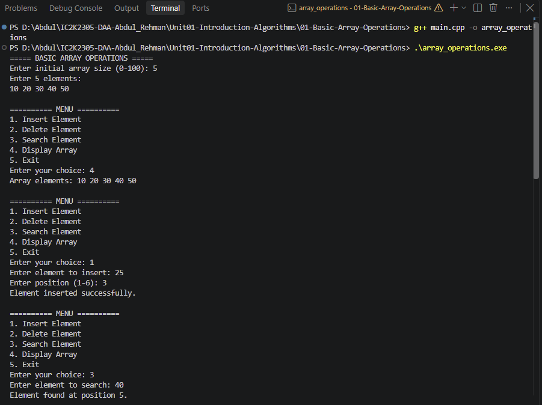
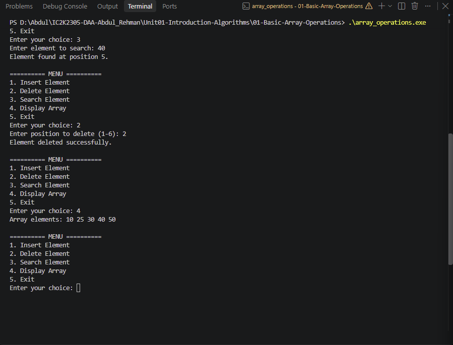

# Experiment 01: Basic Operations on Arrays

## 1. Problem Statement

Write a C++ program to perform basic operations on an array, including insertion, deletion, searching, and displaying elements.

## 2. Algorithm / Approach

The program uses a menu-driven approach to perform different array operations.

- Insertion: Shifts elements to the right and inserts an element at the specified position.
- Deletion: Removes an element and shifts subsequent elements to the left.
- Searching: Uses Linear Search to find the required element.
- Display: Traverses the array and prints all elements.

## 3. Pseudocode

START

1. Initialize an array and read its size.
2. Read array elements.
3. Display the menu.
4. Read the user's choice.

5. If choice is 1:
   - Read element and position.
   - Shift elements right.
   - Insert the element.

6. If choice is 2:
   - Read position.
   - Shift elements left.
   - Reduce array size.

7. If choice is 3:
   - Read search element.
   - Compare with each array element.
   - Display search result.

8. If choice is 4:
   - Display all array elements.

9. If choice is 5:
   - Exit the program.

10. Otherwise, display invalid choice.

11. Repeat until the user chooses Exit.

STOP

## 4. Time and Space Complexity

| Operation     | Time Complexity |
| ------------- | --------------- |
| Display       | O(n)            |
| Insertion     | O(n)            |
| Deletion      | O(n)            |
| Linear Search | O(n)            |

Space Complexity: O(1) auxiliary space.

The program uses a fixed-size array of 100 elements.

## 5. Sample Input

Initial Array:
10 20 30 40 50

Insert 25 at position 3.

Search for 40.

Delete element at position 2.

## 6. Sample Output

Array elements: 10 20 30 40 50

Element inserted successfully.

Array elements: 10 20 25 30 40 50

Element found at position 5.

Element deleted successfully.

Array elements: 10 25 30 40 50

## 7. Screenshots

## 8. Learning Outcomes

- Understood the concept of arrays.
- Learned insertion and deletion operations.
- Implemented Linear Search.
- Understood element shifting in arrays.
- Analyzed the time complexity of basic array operations.
