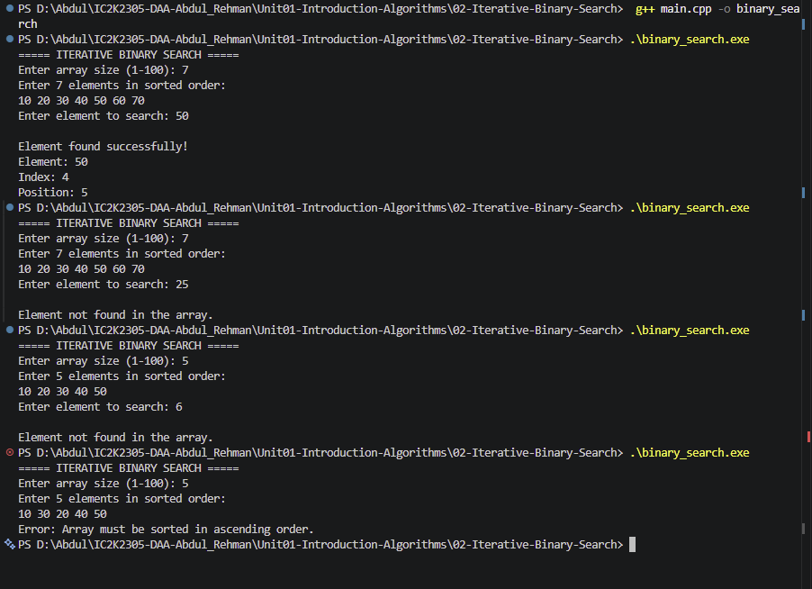

# Experiment 02: Iterative Binary Search

## 1. Problem Statement

Write a C++ program to implement Iterative Binary Search to find a given element in a sorted array. Display the position of the element if found; otherwise, display an appropriate message.

## 2. Algorithm / Approach

Binary Search is a searching technique that works on sorted arrays.

The algorithm repeatedly divides the search space into two halves.

- Initialize low to 0 and high to n-1.
- Calculate the middle index.
- If the middle element matches the target, return its index.
- If the target is greater, search the right half.
- If the target is smaller, search the left half.
- Repeat until the element is found or the search space becomes empty.

The algorithm uses an iterative approach with a while loop.

## 3. Pseudocode

START

1. Read array size and elements.
2. Read the target element.
3. Initialize low = 0 and high = n-1.
4. While low <= high:
   - Calculate mid = low + (high-low)/2.
   - If arr[mid] == target, return mid.
   - If arr[mid] < target, update low = mid+1.
   - Otherwise, update high = mid-1.
5. If the loop terminates, return -1.
6. Display the search result.

STOP

## 4. Time and Space Complexity

| Case         | Time Complexity |
| ------------ | --------------- |
| Best Case    | O(1)            |
| Average Case | O(log n)        |
| Worst Case   | O(log n)        |

Space Complexity: O(1)

## 5. Sample Input

Array: 10 20 30 40 50 60 70

Target: 50

## 6. Sample Output

Element found successfully!

Element: 50
Index: 4
Position: 5

## 7. Screenshots

## 8. Learning Outcomes

- Understood the concept of Binary Search.
- Learned how to divide a search space into two halves.
- Implemented Binary Search using iteration.
- Understood the importance of sorted arrays.
- Analyzed best, average and worst-case time complexity.
- Understood the difference between Linear Search and Binary Search.
