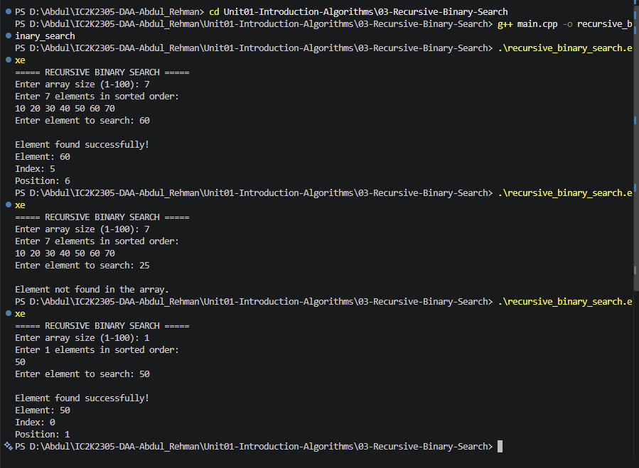

# Experiment 03: Recursive Binary Search

## 1. Problem Statement

Write a C++ program to implement Recursive Binary Search to find a given element in a sorted array. Display the position of the element if found; otherwise, display an appropriate message.

## 2. Algorithm / Approach

Recursive Binary Search is an efficient searching algorithm that repeatedly divides a sorted array into two halves.

It uses recursion instead of iteration.

The algorithm follows these steps:

- Initialize low = 0 and high = n-1.
- Calculate the middle index.
- If the middle element matches the target, return its index.
- If the target is greater than the middle element, recursively search the right half.
- Otherwise, recursively search the left half.
- If low becomes greater than high, return -1.

## 3. Pseudocode

START

1. Read array size and elements.
2. Read the target element.
3. Call binarySearch(arr, 0, n-1, target).

4. Inside binarySearch:
   - If low > high, return -1.
   - Calculate mid = low + (high-low)/2.
   - If arr[mid] == target, return mid.
   - If arr[mid] < target, recursively search right half.
   - Otherwise, recursively search left half.

5. Display the search result.

STOP

## 4. Time and Space Complexity

| Case         | Time Complexity |
| ------------ | --------------- |
| Best Case    | O(1)            |
| Average Case | O(log n)        |
| Worst Case   | O(log n)        |

Space Complexity: O(log n)

The recursive function uses additional stack memory for each function call.

## 5. Sample Input

Array: 10 20 30 40 50 60 70

Target: 60

## 6. Sample Output

Element found successfully!

Element: 60
Index: 5
Position: 6

## 7. Screenshots

## 8. Learning Outcomes

- Understood the concept of recursion.
- Implemented Binary Search using recursive function calls.
- Learned about base conditions in recursion.
- Understood how recursive calls divide the search space.
- Analyzed time and space complexity.
- Compared iterative and recursive searching techniques.
