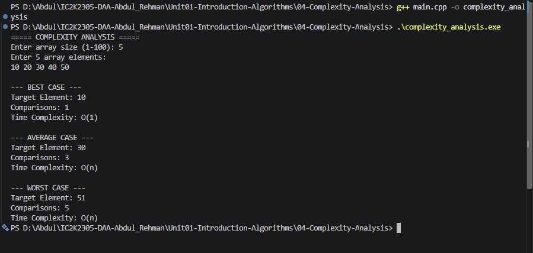

# Experiment 04: Best, Average and Worst-Case Complexity Analysis

## 1. Problem Statement

Write a C++ program to demonstrate the best-case, average-case and worst-case time complexity of Linear Search by counting the number of comparisons performed during searching.

## 2. Algorithm / Approach

The program uses Linear Search to analyze different input scenarios.

- Best Case: The target element is at the first position.
- Average Case: The target element is at the middle position as an illustrative average-position test.
- Worst Case: The target element is absent from the array.

The number of comparisons is counted and displayed for each case.

## 3. Pseudocode

START

1. Read array size and elements.

2. Best Case:
   - Search for the first element.
   - Count comparisons.

3. Average Case:
   - Search for the middle-position element.
   - Count comparisons.

4. Worst Case:
   - Search for an element not present.
   - Count comparisons.

5. Display comparison counts.

STOP

## 4. Time and Space Complexity

| Case    | Time Complexity | Space Complexity |
| ------- | --------------- | ---------------- |
| Best    | O(1)            | O(1)             |
| Average | O(n)            | O(1)             |
| Worst   | O(n)            | O(1)             |

## 5. Sample Input

Array Size: 5

Array Elements: 10 20 30 40 50

## 6. Sample Output

BEST CASE:
Target Element: 10
Comparisons: 1
Time Complexity: O(1)

AVERAGE CASE:
Target Element: 30
Comparisons: 3
Time Complexity: O(n)

WORST CASE:
Target Element: 51
Comparisons: 5
Time Complexity: O(n)

## 7. Screenshots

## 8. Learning Outcomes

- Understood best-case, average-case and worst-case analysis.
- Learned how to count comparisons in an algorithm.
- Understood Linear Search performance.
- Learned the relationship between input size and algorithm efficiency.
- Understood theoretical time complexity.
