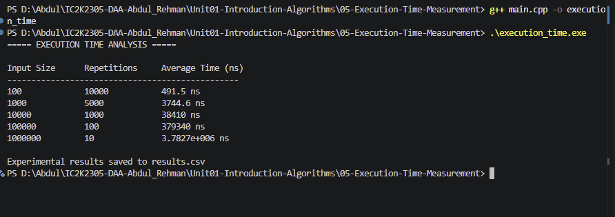

# Experiment 05: Execution Time Measurement

## 1. Problem Statement

Write a C++ program to measure the execution time of Linear Search for different input sizes. Generate arrays, execute the searching algorithm, calculate average execution time and store the experimental results in a CSV file.

## 2. Algorithm / Approach

The program uses Linear Search to measure execution time for different input sizes.

The following input sizes are considered:

- 100
- 1,000
- 10,000
- 100,000
- 1,000,000

The program generates arrays containing sequential values and searches for the last element.

The chrono library is used to measure execution time.

Multiple repetitions are performed for each input size to calculate average execution time.

The experimental results are stored in results.csv.

## 3. Pseudocode

START

1. Define different input sizes.
2. Open results.csv.
3. For each input size:
   - Generate an array.
   - Fill it with sequential values.
   - Select the last element as target.
   - Record starting time.
   - Perform Linear Search multiple times.
   - Record ending time.
   - Calculate average execution time.
   - Display the results.
   - Save results in CSV.
4. Close the CSV file.

STOP

## 4. Time and Space Complexity

| Case         | Time Complexity |
| ------------ | --------------- |
| Best Case    | O(1)            |
| Average Case | O(n)            |
| Worst Case   | O(n)            |

Space Complexity of Linear Search: O(1).

The complete experiment requires O(n) space for the generated array.

## 5. Experimental Input

Input Sizes:

100, 1000, 10000, 100000, 1000000

Search Target: Last element of each array.

## 6. Experimental Results

The program measures average execution time in nanoseconds.

The results are automatically stored in results.csv.

Actual execution times depend on the hardware and system conditions.

## 7. Screenshots

## 8. Learning Outcomes

- Learned how to measure algorithm execution time.
- Understood the chrono library in C++.
- Learned how to generate different input sizes.
- Understood the relationship between input size and execution time.
- Learned how to store experimental results in CSV format.
- Understood the difference between theoretical and experimental analysis.
