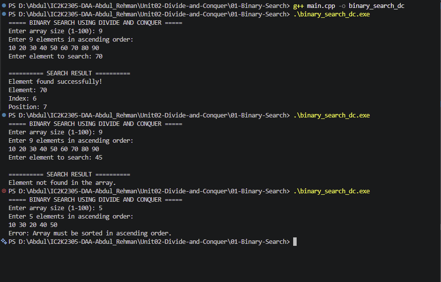

# Experiment 01: Binary Search using Divide and Conquer

## 1. Problem Statement

Write a C++ program to implement Binary Search using the Divide and Conquer technique to find a given element in a sorted array.

## 2. Algorithm / Approach

Binary Search is an efficient searching algorithm based on the Divide and Conquer technique.

It divides the sorted array into two halves by calculating the middle element.

The algorithm follows three steps:

- Divide: Find the middle element and divide the search space into two halves.
- Conquer: Recursively search the appropriate half based on the comparison with the target.
- Combine: Return the result obtained from the recursive call.

The process continues until the element is found or the search space becomes empty.

## 3. Pseudocode

START

1. Read array size and elements.
2. Read the target element.
3. Call binarySearch(arr, 0, n-1, target).

4. Inside binarySearch:
   - If low > high, return -1.
   - Calculate mid = low + (high-low)/2.
   - If arr[mid] == target, return mid.
   - If arr[mid] < target, search right half recursively.
   - Otherwise, search left half recursively.

5. Display the search result.

STOP

## 4. Time and Space Complexity

| Case         | Time Complexity |
| ------------ | --------------- |
| Best Case    | O(1)            |
| Average Case | O(log n)        |
| Worst Case   | O(log n)        |

Space Complexity: O(log n)

Recursive function calls require additional stack memory.

## 5. Sample Input

Array: 10 20 30 40 50 60 70 80 90

Target: 70

## 6. Sample Output

Element found successfully!

Element: 70
Index: 6
Position: 7

## 7. Screenshots

## 8. Learning Outcomes

- Understood the Divide and Conquer technique.
- Learned how Binary Search divides a problem into smaller subproblems.
- Implemented recursive Binary Search in C++.
- Understood base conditions and recursive calls.
- Analyzed time and space complexity.
- Learned the difference between iterative and recursive approaches.
