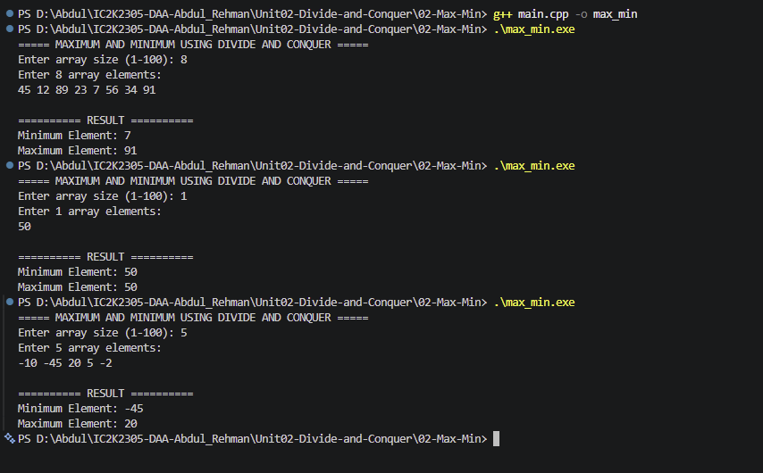

# Experiment 02: Maximum and Minimum using Divide and Conquer

## 1. Problem Statement

Write a C++ program to find the maximum and minimum elements in an array using the Divide and Conquer technique.

The array is divided into smaller subarrays, and the maximum and minimum values are calculated recursively.

## 2. Algorithm / Approach

The program uses the Divide and Conquer technique to find the maximum and minimum elements.

The algorithm follows three steps:

- Divide: Split the array into two halves.
- Conquer: Recursively find the minimum and maximum elements in both halves.
- Combine: Compare the results from both halves to obtain the overall minimum and maximum.

Base Cases:

- If the subarray contains one element, it is both minimum and maximum.
- If the subarray contains two elements, compare them once to determine minimum and maximum.

## 3. Pseudocode

START

1. Read array size and elements.
2. Call findMinMax(arr, 0, n-1).

3. Inside findMinMax:
   - If low == high, return the same element as minimum and maximum.
   - If high == low+1, compare both elements and return minimum and maximum.
   - Calculate mid = (low+high)/2.
   - Recursively find minimum and maximum in the left half.
   - Recursively find minimum and maximum in the right half.
   - Combine both results using min() and max().

4. Display minimum and maximum.

STOP

## 4. Time and Space Complexity

| Case         | Time Complexity |
| ------------ | --------------- |
| Best Case    | O(n)            |
| Average Case | O(n)            |
| Worst Case   | O(n)            |

Space Complexity: O(log n)

The recursive calls require stack memory proportional to the depth of the recursion tree.

For n being a power of two, the algorithm performs approximately 3n/2 - 2 comparisons.

## 5. Sample Input

Array Size: 8

Array Elements: 45 12 89 23 7 56 34 91

## 6. Sample Output

Minimum Element: 7
Maximum Element: 91

## 7. Screenshots

## 8. Learning Outcomes

- Understood the Divide and Conquer technique.
- Learned how to divide an array into smaller subarrays.
- Implemented recursive minimum and maximum operations.
- Understood base cases in recursive algorithms.
- Learned how to combine results from recursive calls.
- Analyzed time and space complexity.
