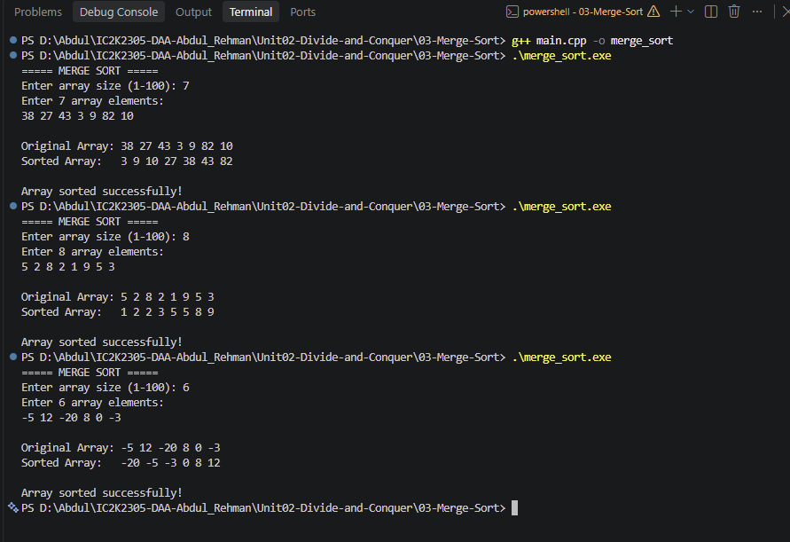

# Experiment 03: Merge Sort

## 1. Problem Statement

Write a C++ program to sort an array of integers in ascending order using the Merge Sort algorithm.

## 2. Algorithm / Approach

Merge Sort is a sorting algorithm based on the Divide and Conquer technique.

It divides the array into two halves, recursively sorts both halves, and merges them into a single sorted array.

The algorithm follows three steps:

- Divide: Split the array into two smaller subarrays.
- Conquer: Recursively sort both subarrays.
- Combine: Merge both sorted subarrays into a single sorted array.

The process continues until each subarray contains only one element.

## 3. Pseudocode

START

1. Read array size and elements.
2. Call mergeSort(arr, 0, n-1).

3. Inside mergeSort:
   - If low < high:
   - Calculate mid = low + (high-low)/2.
   - Recursively sort the left half.
   - Recursively sort the right half.
   - Merge both sorted halves.

4. Inside merge:
   - Compare elements from both halves.
   - Copy the smaller element into the original array.
   - Copy remaining elements.

5. Display the sorted array.

STOP

## 4. Time and Space Complexity

| Case         | Time Complexity |
| ------------ | --------------- |
| Best Case    | O(n log n)      |
| Average Case | O(n log n)      |
| Worst Case   | O(n log n)      |

Space Complexity: O(n)

Merge Sort requires additional memory for temporary arrays during merging.

## 5. Sample Input

Array Size: 7

Array Elements: 38 27 43 3 9 82 10

## 6. Sample Output

Original Array: 38 27 43 3 9 82 10

Sorted Array: 3 9 10 27 38 43 82

Array sorted successfully!

## 7. Screenshots

## 8. Learning Outcomes

- Understood the Divide and Conquer technique.
- Learned how to divide an array into smaller subarrays.
- Implemented Merge Sort using recursion.
- Understood the merging process.
- Learned how to sort elements in ascending order.
- Analyzed the time and space complexity of Merge Sort.
