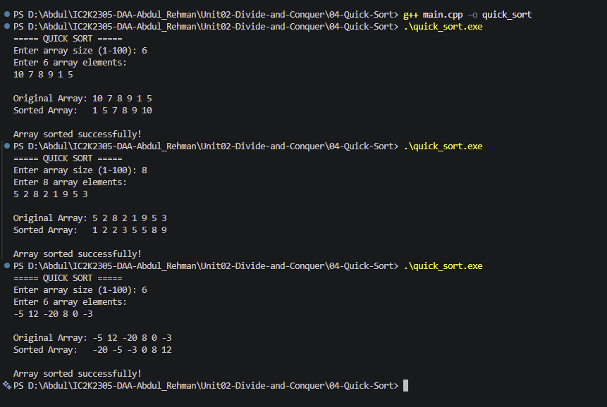

# Experiment 04: Quick Sort

## 1. Problem Statement

Write a C++ program to sort an array of integers in ascending order using the Quick Sort algorithm.

## 2. Algorithm / Approach

Quick Sort is a sorting algorithm based on the Divide and Conquer technique.

It selects a pivot element and partitions the array so that smaller elements are placed on the left and larger elements on the right.

The algorithm follows three steps:

- Divide: Select a pivot and partition the array.
- Conquer: Recursively sort the left and right subarrays.
- Combine: No separate merging is required because the pivot reaches its correct position.

The last element is selected as the pivot in this implementation.

## 3. Pseudocode

START

1. Read array size and elements.
2. Call quickSort(arr, 0, n-1).

3. Inside quickSort:
   - If low < high:
   - Find pivotIndex using partition().
   - Recursively sort the left subarray.
   - Recursively sort the right subarray.

4. Inside partition:
   - Select the last element as pivot.
   - Compare all elements with the pivot.
   - Move smaller elements to the left.
   - Place pivot at its correct position.
   - Return pivot index.

5. Display sorted array.

STOP

## 4. Time and Space Complexity

| Case         | Time Complexity |
| ------------ | --------------- |
| Best Case    | O(n log n)      |
| Average Case | O(n log n)      |
| Worst Case   | O(n²)           |

Space Complexity:

- Average Case: O(log n)
- Worst Case: O(n)

## 5. Sample Input

Array Size: 6

Array Elements: 10 7 8 9 1 5

## 6. Sample Output

Original Array: 10 7 8 9 1 5

Sorted Array: 1 5 7 8 9 10

Array sorted successfully!

## 7. Screenshots

## 8. Learning Outcomes

- Understood the Quick Sort algorithm.
- Learned how to select a pivot element.
- Implemented the partitioning technique.
- Understood recursive sorting.
- Learned the Divide and Conquer approach.
- Analyzed best, average and worst-case complexity.
