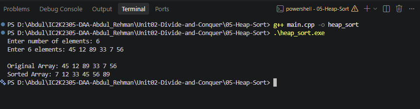

# Experiment 05: Heap Sort

## Aim

To implement Heap Sort using the Binary Heap data structure in C++.

## Problem Statement

Write a C++ program to sort an array of elements in ascending order using the Heap Sort algorithm.

## Algorithm / Approach

Heap Sort uses a Max Heap, where every parent node is greater than or equal to its child nodes.

Steps:

1. Build a Max Heap from the given array.
2. The root of the Max Heap contains the largest element.
3. Swap the root element with the last element.
4. Reduce the heap size by one.
5. Apply heapify to restore the Max Heap property.
6. Repeat until all elements are sorted.

## Pseudocode

HEAP-SORT(A):

1. Build a Max Heap from A.
2. For i = n-1 down to 1:
   a. Swap A[0] and A[i].
   b. Reduce heap size to i.
   c. Apply MAX-HEAPIFY(A, 0).

MAX-HEAPIFY(A, i):

1. Find the largest among:
   - Current node
   - Left child
   - Right child
2. If the largest is not the current node:
   a. Swap the current node with the largest child.
   b. Recursively apply MAX-HEAPIFY.

## Time Complexity

| Case         | Complexity |
| ------------ | ---------- |
| Best Case    | O(n log n) |
| Average Case | O(n log n) |
| Worst Case   | O(n log n) |

## Space Complexity

O(log n) auxiliary space due to recursive heapify calls.

## Sample Input

6
45 12 89 33 7 56

## Sample Output

7 12 33 45 56 89

## Test Cases

| Test Case | Input          | Expected Output |
| --------- | -------------- | --------------- |
| 1         | 5 4 2 8 1 3    | 1 2 3 4 8       |
| 2         | 4 10 10 5 5    | 5 5 10 10       |
| 3         | 5 -3 0 -8 2 -1 | -8 -3 -1 0 2    |
| 4         | 1 25           | 25              |

## Screenshots

## Learning Outcomes

- Understood the concept of a Binary Heap.
- Learned how to construct a Max Heap.
- Implemented the Heap Sort algorithm.
- Understood the time and space complexity of Heap Sort.
