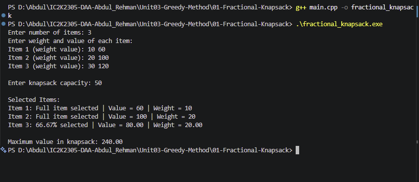

# Experiment 01: Fractional Knapsack

## Aim

To implement the Fractional Knapsack problem using the Greedy Method in C++.

## Problem Statement

Given a set of items, each having a weight and value, and a knapsack with a fixed capacity, find the maximum total value that can be obtained by selecting items or fractions of items.

## Algorithm / Approach

The Fractional Knapsack problem uses a Greedy strategy.

1. Calculate the value-to-weight ratio for every item.
2. Sort all items in decreasing order of this ratio.
3. Select the item with the highest ratio first.
4. If the complete item fits, add it to the knapsack.
5. Otherwise, take only the fraction that fits.
6. Repeat until the knapsack becomes full or all items are considered.

## Pseudocode

FRACTIONAL-KNAPSACK(items, capacity):

1. For every item:
   Calculate ratio = value / weight.

2. Sort items in descending order of ratio.

3. totalValue = 0.

4. For each item:
   a. If capacity is 0, stop.
   b. If item weight <= capacity:
   - Take the complete item.
   - Subtract its weight from capacity.
   - Add its value to totalValue.
     c. Otherwise:
   - Calculate fraction = capacity / item weight.
   - Add fraction \* item value to totalValue.
   - Set capacity = 0.

5. Return totalValue.

## Time Complexity

| Operation        | Complexity |
| ---------------- | ---------- |
| Calculate ratios | O(n)       |
| Sort items       | O(n log n) |
| Select items     | O(n)       |
| Overall          | O(n log n) |

## Space Complexity

O(n) for storing the items.

## Sample Input

3
10 60
20 100
30 120
50

## Sample Output

Maximum value in knapsack: 240.00

## Test Cases

| Test Case | Capacity | Expected Maximum Value |
| --------- | -------: | ---------------------: |
| 1         |       50 |                    240 |
| 2         |       60 |                    280 |
| 3         |       10 |                     60 |
| 4         |        0 |                      0 |

## Screenshots

## Learning Outcomes

- Understood the Greedy Method.
- Learned the concept of value-to-weight ratio.
- Implemented Fractional Knapsack using C++.
- Understood how sorting helps in greedy selection.
- Analyzed the time and space complexity.
- Understood the difference between Fractional and 0/1 Knapsack.
