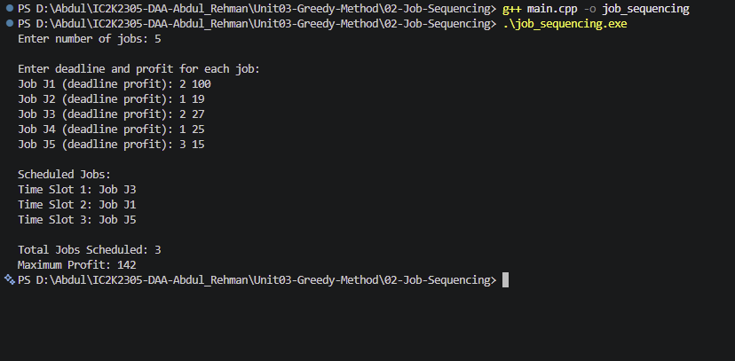

# Experiment 02: Job Sequencing with Deadlines

## Aim

To implement Job Sequencing with Deadlines using the Greedy Method in C++.

## Problem Statement

Given a set of jobs, where each job has a deadline and profit, schedule the jobs to maximize the total profit.

Each job takes one unit of time, and only one job can be performed in a time slot.

## Algorithm / Approach

The algorithm follows a Greedy strategy:

1. Sort all jobs in descending order of profit.
2. Find the maximum deadline.
3. Create time slots initially marked as empty.
4. Consider jobs one by one in sorted order.
5. For each job, search for the latest available slot on or before its deadline.
6. If a slot is available, schedule the job and add its profit.
7. If no slot is available, skip the job.
8. Display the scheduled jobs and maximum profit.

## Pseudocode

JOB-SEQUENCING(jobs, n):

1. Sort jobs in descending order of profit.
2. Find the maximum deadline.
3. Create empty time slots.
4. totalProfit = 0.

5. For each job:
   a. Start from its deadline.
   b. Search backwards for an empty slot.
   c. If an empty slot is found:
   - Assign the job to that slot.
   - Add its profit to totalProfit.
     d. Otherwise, skip the job.

6. Display scheduled jobs.
7. Display totalProfit.

## Time Complexity

Let:

- n = Number of jobs
- D = Maximum deadline

| Operation                | Complexity      |
| ------------------------ | --------------- |
| Sorting jobs             | O(n log n)      |
| Finding maximum deadline | O(n)            |
| Scheduling jobs          | O(nD)           |
| Overall                  | O(n log n + nD) |

If D is proportional to n, the worst-case time complexity is O(n²).

## Space Complexity

O(D) auxiliary space for storing time slots.

## Sample Input

5
2 100
1 19
2 27
1 25
3 15

## Sample Output

Scheduled Jobs:
Time Slot 1: Job J3
Time Slot 2: Job J1
Time Slot 3: Job J5

Total Jobs Scheduled: 3
Maximum Profit: 142

## Test Cases

| Test Case | Expected Result      |
| --------- | -------------------- |
| 1         | Maximum profit = 142 |
| 2         | Maximum profit = 280 |
| 3         | Maximum profit = 50  |
| 4         | Maximum profit = 0   |

## Screenshots

## Learning Outcomes

- Understood the Greedy Method.
- Learned Job Sequencing with Deadlines.
- Understood profit-based sorting.
- Learned how to allocate jobs to available time slots.
- Understood how greedy selection maximizes total profit.
- Analyzed the time and space complexity.
