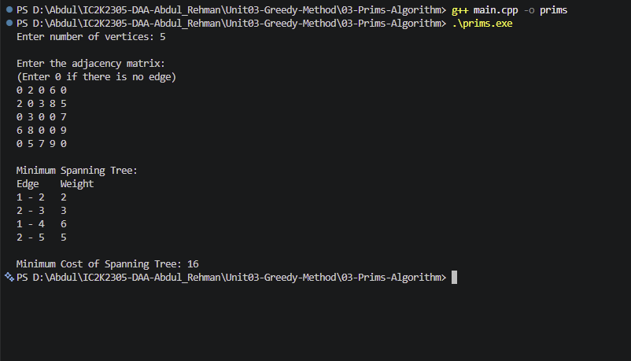

# Experiment 03: Prim's Algorithm

## Aim

To implement Prim's Algorithm to find the Minimum Spanning Tree of a connected, weighted, undirected graph using C++.

## Problem Statement

Given a connected, weighted, undirected graph, find a spanning tree having the minimum possible total edge weight.

## Algorithm / Approach

Prim's Algorithm follows the Greedy Method.

1. Start from any vertex.
2. Mark the starting vertex as visited.
3. Find the minimum-weight edge connecting a visited vertex to an unvisited vertex.
4. Add that edge and the new vertex to the Minimum Spanning Tree.
5. Repeat until all vertices are visited.
6. Calculate and display the total weight of the selected edges.

## Pseudocode

PRIM(graph, n):

1. Initialize all key values to infinity.
2. Initialize all parent values to -1.
3. Mark all vertices as unvisited.
4. Set key[0] = 0.

5. Repeat n times:
   a. Find the unvisited vertex u with minimum key.
   b. If no such vertex exists, report that the graph is disconnected.
   c. Mark u as visited.
   d. For every adjacent unvisited vertex v:
   - If weight(u, v) < key[v]:
     Update key[v] and parent[v].

6. Display the selected edges.
7. Calculate and display the total cost.

## Time Complexity

Using an adjacency matrix:

| Operation                  | Complexity |
| -------------------------- | ---------- |
| Finding minimum key vertex | O(V)       |
| Updating adjacent vertices | O(V)       |
| Repeating for all vertices | O(V²)      |
| Overall                    | O(V²)      |

## Space Complexity

O(V²) including the adjacency matrix.

Auxiliary space used by the algorithm is O(V).

## Sample Input

5
0 2 0 6 0
2 0 3 8 5
0 3 0 0 7
6 8 0 0 9
0 5 7 9 0

## Sample Output

Minimum Spanning Tree:
Edge Weight
1 - 2 2
2 - 3 3
2 - 5 5
1 - 4 6

Minimum Cost of Spanning Tree: 16

## Test Cases

| Test Case | Expected Result                                  |
| --------- | ------------------------------------------------ |
| 1         | MST cost = 16                                    |
| 2         | MST cost = 6 for a triangle with weights 1, 2, 3 |
| 3         | Disconnected graph should be detected            |
| 4         | Single vertex should have MST cost = 0           |

## Screenshots

## Learning Outcomes

- Understood the concept of a Spanning Tree.
- Learned the Minimum Spanning Tree problem.
- Understood the Greedy Method.
- Implemented Prim's Algorithm using an adjacency matrix.
- Learned how to select minimum-weight edges without creating cycles.
- Analyzed time and space complexity.
