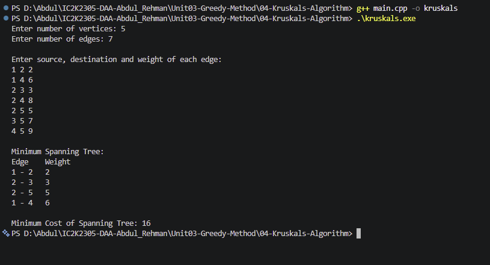

# Experiment 04: Kruskal's Algorithm

## Aim

To implement Kruskal's Algorithm to find the Minimum Spanning Tree of a connected, weighted, undirected graph using C++.

## Problem Statement

Given a connected, weighted, undirected graph, find a spanning tree having the minimum possible total edge weight without forming any cycle.

## Algorithm / Approach

Kruskal's Algorithm follows the Greedy Method.

1. Sort all graph edges in ascending order of weight.
2. Initialize each vertex as a separate set.
3. Select the edge with the minimum weight.
4. Check whether its two vertices belong to different sets.
5. If they belong to different sets:
   - Add the edge to the MST.
   - Merge their sets.
6. If they belong to the same set, reject the edge because it creates a cycle.
7. Repeat until V-1 edges are selected.

## Pseudocode

KRUSKAL(graph):

1. Sort all edges in ascending order of weight.
2. Initialize a separate set for every vertex.
3. totalCost = 0.
4. edgesSelected = 0.

5. For every edge (u, v, weight):
   a. Find the representative of u.
   b. Find the representative of v.
   c. If both representatives are different:
   - Add the edge to MST.
   - Merge both sets.
   - Add weight to totalCost.
   - Increase edgesSelected.
     d. If edgesSelected = V-1, stop.

6. If edgesSelected is not V-1:
   Report that the graph is disconnected.
7. Otherwise, display the MST and totalCost.

## Time Complexity

Let:

- V = Number of vertices
- E = Number of edges

| Operation                 | Complexity |
| ------------------------- | ---------- |
| Sorting edges             | O(E log E) |
| Find and Union operations | O(E α(V))  |
| Overall                   | O(E log E) |

Here, α(V) is the inverse Ackermann function, which grows extremely slowly.

## Space Complexity

O(V + E) including the edge list and Disjoint Set Union arrays.

## Sample Input

5
7
1 2 2
1 4 6
2 3 3
2 4 8
2 5 5
3 5 7
4 5 9

## Sample Output

Minimum Spanning Tree:
Edge Weight
1 - 2 2
2 - 3 3
2 - 5 5
1 - 4 6

Minimum Cost of Spanning Tree: 16

## Test Cases

| Test Case | Expected Result                             |
| --------- | ------------------------------------------- |
| 1         | MST cost = 16                               |
| 2         | Triangle with weights 1, 2, 3: MST cost = 3 |
| 3         | Disconnected graph: MST cannot be formed    |
| 4         | Single vertex: MST cost = 0                 |

## Screenshots

## Learning Outcomes

- Understood the Minimum Spanning Tree problem.
- Learned Kruskal's Greedy Algorithm.
- Understood edge sorting and cycle detection.
- Learned the Disjoint Set Union data structure.
- Understood Find and Union operations.
- Analyzed time and space complexity.
- Learned how to construct an MST without cycles.
