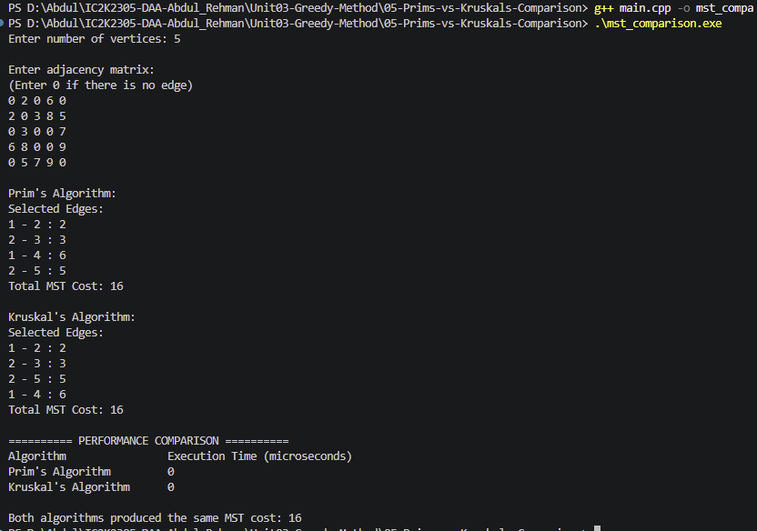

# Experiment 05: Prim's vs. Kruskal's Algorithm Comparison

## Aim

To compare Prim's and Kruskal's algorithms for finding a Minimum Spanning Tree based on their execution time, selected edges, and complexity.

## Problem Statement

Implement Prim's and Kruskal's algorithms and compare their performance on the same weighted, undirected graph.

## Algorithm / Approach

### Prim's Algorithm

1. Start from a vertex.
2. Select the minimum-weight edge connecting a visited vertex to an unvisited vertex.
3. Add the edge to the MST.
4. Repeat until all vertices are visited.

### Kruskal's Algorithm

1. Sort all edges in ascending order of weight.
2. Select the smallest edge.
3. Use Disjoint Set Union to check whether it creates a cycle.
4. Add the edge if it does not create a cycle.
5. Repeat until V-1 edges are selected.

## Performance Measurement

The program:

1. Accepts an adjacency matrix as input.
2. Converts the graph into an edge list for Kruskal's Algorithm.
3. Measures Prim's execution time.
4. Measures Kruskal's execution time.
5. Displays the MST edges and total costs.
6. Compares the execution times and verifies that both algorithms produce the same MST cost.

## Sample Input

5
0 2 0 6 0
2 0 3 8 5
0 3 0 0 7
6 8 0 0 9
0 5 7 9 0

## Sample Output

Prim's Algorithm:
Total MST Cost: 16

Kruskal's Algorithm:
Total MST Cost: 16

Both algorithms produced the same MST cost: 16

Execution times depend on the computer and current system load.

## Complexity Comparison

| Parameter        | Prim's Algorithm                | Kruskal's Algorithm               |
| ---------------- | ------------------------------- | --------------------------------- |
| Time Complexity  | O(V²)                           | O(E log E)                        |
| Space Complexity | O(V²)                           | O(V + E)                          |
| Data Structure   | Adjacency Matrix                | Edge List and DSU                 |
| Main Operation   | Selecting minimum adjacent edge | Sorting edges and cycle detection |

## Experimental Results

Run both algorithms on graphs of different sizes.

| Graph Size | Number of Vertices |     Prim's Time (µs) |  Kruskal's Time (µs) |             MST Cost |
| ---------- | -----------------: | -------------------: | -------------------: | -------------------: |
| Small      |                  5 | Record actual result | Record actual result |                   16 |
| Medium     |                 10 | Record actual result | Record actual result | Record actual result |
| Large      |                 20 | Record actual result | Record actual result | Record actual result |

Note: Record actual execution times from program runs. Do not use invented timing values.

## Screenshots

## Learning Outcomes

- Understood Prim's and Kruskal's algorithms.
- Learned the differences between the two MST algorithms.
- Compared execution times.
- Understood the role of adjacency matrices, edge lists, and DSU.
- Analyzed time and space complexity.
- Learned how graph representation affects algorithm performance.
