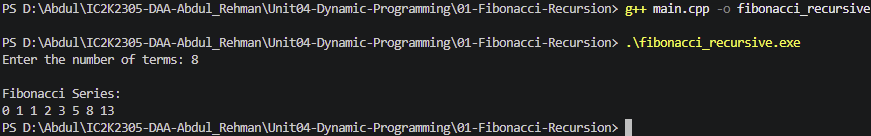

# Experiment 01: Fibonacci using Recursion

## Aim

To generate the Fibonacci sequence using recursion in C++.

## Problem Statement

Write a C++ program to generate the Fibonacci sequence for a given number of terms using a recursive function.

## Algorithm / Approach

1. Accept the number of terms from the user.
2. Define a recursive Fibonacci function.
3. Return 0 when n = 0.
4. Return 1 when n = 1.
5. Otherwise, return fibonacci(n-1) + fibonacci(n-2).
6. Call the function for each term and display the sequence.

## Pseudocode

FIBONACCI(n):

1. If n = 0:
   Return 0.

2. If n = 1:
   Return 1.

3. Return FIBONACCI(n-1) + FIBONACCI(n-2).

MAIN:

1. Read number of terms n.
2. For i = 0 to n-1:
   Display FIBONACCI(i).

## Time Complexity

O(2^n) approximately, for calculating the nth Fibonacci number using basic recursion.

## Space Complexity

O(n) due to the maximum recursive call stack depth.

## Sample Input

8

## Sample Output

Fibonacci Series:
0 1 1 2 3 5 8 13

## Test Cases

| Test Case | Input | Expected Output  |
| --------- | ----: | ---------------- |
| 1         |     1 | 0                |
| 2         |     2 | 0 1              |
| 3         |     5 | 0 1 1 2 3        |
| 4         |     8 | 0 1 1 2 3 5 8 13 |

## Screenshots

## Learning Outcomes

- Understood the Fibonacci sequence.
- Learned the concept of recursion.
- Implemented Fibonacci using a recursive function.
- Understood base conditions in recursion.
- Learned about repeated calculations in recursive algorithms.
- Analyzed time and space complexity.
