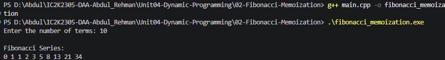

# Experiment 02: Fibonacci using Memoization

## Aim

To implement the Fibonacci sequence using Dynamic Programming with the Memoization technique in C++.

## Problem Statement

Write a C++ program to generate the Fibonacci sequence using recursion with memoization to avoid repeated calculations.

## Algorithm / Approach

Memoization is a Dynamic Programming technique that stores previously calculated results.

1. Create a memoization array initialized with -1.
2. Define a recursive Fibonacci function.
3. If n = 0, return 0.
4. If n = 1, return 1.
5. Check whether the result is already stored.
6. If stored, return the existing result.
7. Otherwise, calculate fibonacci(n-1) + fibonacci(n-2).
8. Store the calculated result in the memoization array.
9. Display the Fibonacci sequence.

## Pseudocode

FIBONACCI(n, memo):

1. If n = 0:
   Return 0.

2. If n = 1:
   Return 1.

3. If memo[n] is not -1:
   Return memo[n].

4. memo[n] = FIBONACCI(n-1, memo) + FIBONACCI(n-2, memo).

5. Return memo[n].

MAIN:

1. Read number of terms n.
2. Initialize memo array with -1.
3. For i = 0 to n-1:
   Display FIBONACCI(i, memo).

## Time Complexity

O(n), because every Fibonacci value is calculated only once.

## Space Complexity

O(n), for the memoization array and recursive call stack.

## Sample Input

10

## Sample Output

Fibonacci Series:
0 1 1 2 3 5 8 13 21 34

## Comparison: Recursion vs. Memoization

| Parameter             | Recursion            | Memoization |
| --------------------- | -------------------- | ----------- |
| Time Complexity       | O(2^n) approximately | O(n)        |
| Space Complexity      | O(n)                 | O(n)        |
| Repeated Calculations | Yes                  | Avoided     |
| Performance           | Slow                 | Faster      |

## Test Cases

| Test Case | Input | Expected Output  |
| --------- | ----: | ---------------- |
| 1         |     1 | 0                |
| 2         |     2 | 0 1              |
| 3         |     5 | 0 1 1 2 3        |
| 4         |     8 | 0 1 1 2 3 5 8 13 |

## Screenshots

## Learning Outcomes

- Understood Dynamic Programming.
- Learned the Memoization technique.
- Implemented Fibonacci using recursion with memoization.
- Understood overlapping subproblems.
- Learned how to store and reuse calculated results.
- Compared recursive and memoized Fibonacci.
- Analyzed time and space complexity.
