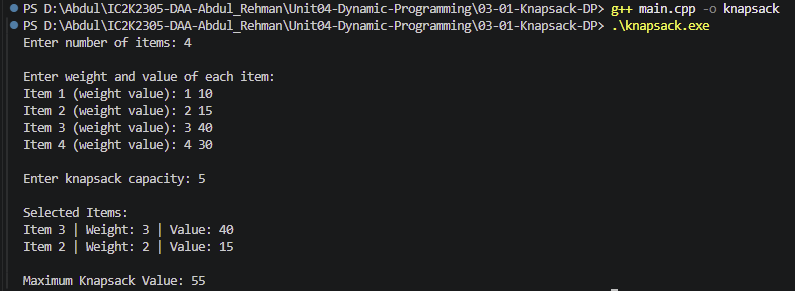

# Experiment 03: 0/1 Knapsack using Dynamic Programming

## Aim

To implement the 0/1 Knapsack problem using Dynamic Programming in C++.

## Problem Statement

Given a set of items, each having a weight and value, and a knapsack with a fixed capacity, select items to maximize the total value without exceeding the capacity.

Each item can either be selected completely or rejected. Fractions of items are not allowed.

## Algorithm / Approach

1. Create a 2D DP table initialized with 0.
2. Consider items one by one.
3. For every item, check all possible capacities.
4. If the item weight exceeds the current capacity, exclude it.
5. Otherwise, calculate two possibilities:
   - Include the current item.
   - Exclude the current item.
6. Store the maximum of these two values.
7. The final answer is stored in dp[n][capacity].
8. Trace the DP table to identify selected items.

## Pseudocode

KNAPSACK(capacity, weights, values, n):

1. Initialize dp[n+1][capacity+1] with 0.

2. For i = 1 to n:
   For w = 0 to capacity:

   If weights[i-1] > w:
   dp[i][w] = dp[i-1][w]

   Otherwise:
   include = values[i-1] + dp[i-1]w-weights[i-1]]
   exclude = dp[i-1][w]
   dp[i][w] = MAX(include, exclude)

3. Return dp[n][capacity].

## Time Complexity

O(n × W)

Where:

- n = Number of items
- W = Knapsack capacity

## Space Complexity

O(n × W) for the 2D DP table.

## Sample Input

4
1 10
2 15
3 40
4 30
5

## Sample Output

Selected Items:
Item 3 | Weight: 3 | Value: 40
Item 2 | Weight: 2 | Value: 15

Maximum Knapsack Value: 55

## Test Cases

| Test Case | Expected Maximum Value |
| --------- | ---------------------: |
| 1         |                     55 |
| 2         |                    280 |
| 3         |                     50 |
| 4         |                      0 |

## Screenshots

## Learning Outcomes

- Understood the 0/1 Knapsack problem.
- Learned Dynamic Programming using a 2D table.
- Understood the include and exclude choices.
- Learned how to find the optimal solution.
- Understood how to trace selected items.
- Analyzed time and space complexity.
