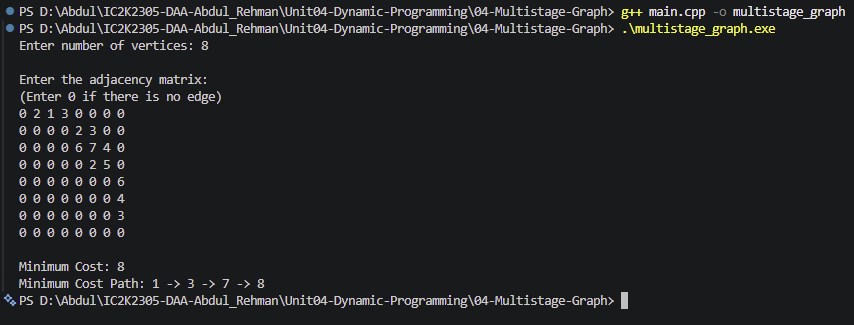

# Experiment 04: Multistage Graph using Dynamic Programming

## Aim

To implement the Multistage Graph problem using Dynamic Programming to find the minimum-cost path from source to destination.

## Problem Statement

Given a directed, weighted multistage graph, find the minimum-cost path from the source vertex to the destination vertex.

## Algorithm / Approach

1. Represent the graph using an adjacency matrix.
2. Initialize the cost array with infinity.
3. Set the destination vertex cost to 0.
4. Process vertices in reverse topological order.
5. For every vertex, examine all reachable next vertices.
6. Calculate the cost of each possible path.
7. Store the minimum cost and the corresponding next vertex.
8. Reconstruct and display the minimum-cost path.

## Pseudocode

MULTISTAGE-GRAPH(graph, n):

1.  Initialize cost[0...n-1] = INFINITY.
2.  Initialize nextVertex[0...n-1] = -1.
3.  Set cost[n-1] = 0.

4.  For u = n-2 down to 0:
    For v = u+1 to n-1:

    If an edge exists between u and v:
    currentCost = weight[u][v] + cost[v]

          If currentCost < cost[u]:
             cost[u] = currentCost
             nextVertex[u] = v

5.  If cost[0] is INFINITY:
    Display that no path exists.

6.  Otherwise:
    Display cost[0].
    Reconstruct the path using nextVertex.

## Time Complexity

O(V²), because every vertex checks the possible next vertices using an adjacency matrix.

## Space Complexity

O(V²), including the adjacency matrix.

Auxiliary space is O(V) for the cost and next-vertex arrays.

## Sample Input

8
0 2 1 3 0 0 0 0
0 0 0 0 2 3 0 0
0 0 0 0 6 7 4 0
0 0 0 0 0 2 5 0
0 0 0 0 0 0 0 6
0 0 0 0 0 0 0 4
0 0 0 0 0 0 0 3
0 0 0 0 0 0 0 0

## Sample Output

Minimum Cost: 8
Minimum Cost Path: 1 -> 3 -> 7 -> 8

## Test Cases

| Test Case | Expected Result                                               |
| --------- | ------------------------------------------------------------- |
| 1         | Minimum cost = 8                                              |
| 2         | Direct path from source to destination: cost = 5              |
| 3         | No path exists between source and destination                 |
| 4         | Multiple possible paths: minimum-cost path should be selected |

## Screenshots

## Learning Outcomes

- Understood the concept of a Multistage Graph.
- Learned how Dynamic Programming solves shortest-path problems.
- Understood reverse topological processing.
- Learned how to calculate minimum path costs.
- Implemented path reconstruction using an array.
- Analyzed time and space complexity.
