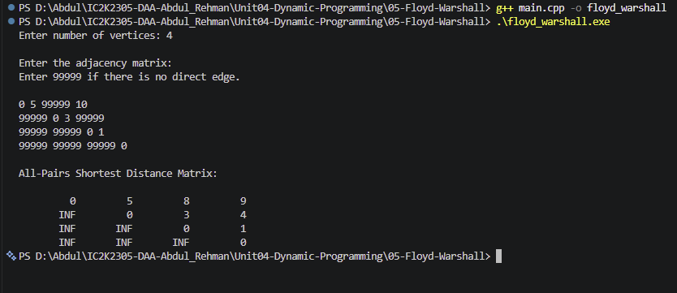

# Experiment 05: Floyd-Warshall Algorithm

## Aim

To implement the Floyd-Warshall algorithm in C++ to find the shortest distances between all pairs of vertices in a weighted graph.

## Problem Statement

Given a weighted graph represented using an adjacency matrix, find the shortest distance between every pair of vertices using the Floyd-Warshall algorithm.

## Algorithm / Approach

The Floyd-Warshall algorithm uses Dynamic Programming to solve the All-Pairs Shortest Path problem.

It considers every vertex as an intermediate vertex and checks whether travelling through that vertex produces a shorter path.

The distance is updated using:

D[i][j] = min(D[i][j], D[i][k] + D[k][j])

The process continues until all vertices have been considered as intermediate vertices.

## Pseudocode

1. Read the number of vertices.
2. Read the adjacency matrix.
3. Initialize the distance matrix.
4. For each vertex k:
   a. For each source vertex i:
   i. For each destination vertex j: - Check whether a path exists from i to k and k to j. - Calculate the distance through k. - Update the distance if the new distance is smaller.
5. Check for a negative-weight cycle.
6. Display the final shortest distance matrix.
7. Stop.

## Time and Space Complexity

**Time Complexity:** O(V^3)

Three nested loops are used to examine every combination of intermediate, source, and destination vertices.

**Space Complexity:** O(V^2)

A two-dimensional distance matrix is used to store the shortest distances between vertices.

Here, V represents the number of vertices.

## Sample Input

4

0 5 99999 10
99999 0 3 99999
99999 99999 0 1
99999 99999 99999 0

## Sample Output

All-Pairs Shortest Distance Matrix:

0 5 8 9
INF 0 3 4
INF INF 0 1
INF INF INF 0

## Screenshots

## Learning Outcomes

- Understood the All-Pairs Shortest Path problem.
- Learned the working of the Floyd-Warshall algorithm.
- Applied Dynamic Programming to graph problems.
- Understood how intermediate vertices help find shorter paths.
- Learned to analyze the time and space complexity of an algorithm.
