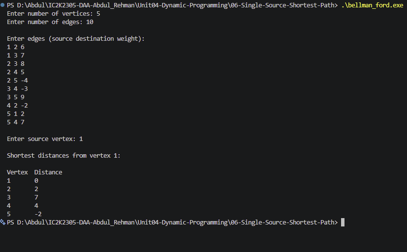

# Experiment 06: Single-Source Shortest Path

## Aim

To implement the Bellman-Ford algorithm in C++ to find the shortest distances from a selected source vertex to all other vertices in a weighted graph.

## Problem Statement

Given a weighted directed graph and a source vertex, find the shortest distance from the source vertex to every other vertex using the Bellman-Ford algorithm.

## Algorithm / Approach

The Bellman-Ford algorithm uses repeated edge relaxation to calculate shortest distances.

1. Initialize the distance of every vertex as infinity.
2. Set the distance of the source vertex to zero.
3. Relax every edge V-1 times.
4. For each edge (u, v), update the distance to v if travelling through u gives a shorter path.
5. Check all edges once more to detect a reachable negative-weight cycle.
6. Display the shortest distances from the source vertex.

## Pseudocode

1. Read the number of vertices and edges.
2. Read all edges with their weights.
3. Read the source vertex.
4. Initialize all distances to infinity.
5. Set the source distance to zero.
6. Repeat V-1 times:
   a. For every edge (u, v):
   - If u is reachable and dist[u] + weight is smaller than dist[v]:
     Update dist[v].
7. Check all edges for further possible relaxation.
8. If relaxation is possible, report a negative-weight cycle.
9. Otherwise, display the shortest distances.
10. Stop.

## Sample Input

5
10

1 2 6
1 3 7
2 3 8
2 4 5
2 5 -4
3 4 -3
3 5 9
4 2 -2
5 1 2
5 4 7

Source vertex: 1

## Sample Output

Vertex Distance
1 0
2 2
3 7
4 4
5 -2

## Time and Space Complexity

**Time Complexity:** O(V × E)

The algorithm relaxes all E edges up to V-1 times and performs one additional pass for negative-cycle detection.

**Space Complexity:** O(V + E)

The distance array requires O(V) space, while the edge list requires O(E) space.

Here:

- V = Number of vertices
- E = Number of edges

## Screenshots

## Learning Outcomes

- Understood the Single-Source Shortest Path problem.
- Learned the Bellman-Ford algorithm.
- Understood edge relaxation.
- Learned how to handle negative edge weights.
- Learned how to detect reachable negative-weight cycles.
- Understood the time and space complexity of the algorithm.
