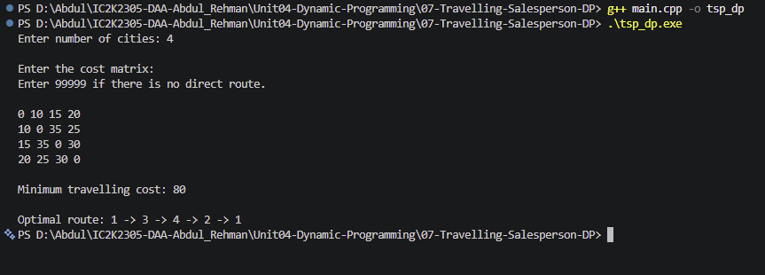

# Experiment 07: Travelling Salesperson Problem using Dynamic Programming

## Aim

To implement the Travelling Salesperson Problem using Bitmask Dynamic Programming in C++ and find the minimum-cost route that visits every city exactly once and returns to the starting city.

## Problem Statement

Given a set of cities and the travelling cost between each pair of cities, find the minimum-cost tour that starts from city 1, visits every other city exactly once, and returns to city 1.

## Algorithm / Approach

The problem is solved using Bitmask Dynamic Programming, also known as the Held-Karp algorithm.

A bitmask represents the cities that have already been visited.

The DP state is:

dp[mask][u]

It represents the minimum cost of visiting all cities in the given mask and ending at city u.

The algorithm:

1. Initialize all DP states with infinity.
2. Set dp[1][0] = 0 because the journey starts from city 1.
3. Consider every possible visited-city mask.
4. For each current city, try visiting every unvisited city.
5. Update the DP state if a cheaper route is found.
6. After visiting all cities, calculate the cost of returning to city 1.
7. Find the minimum total cost.
8. Reconstruct and display the optimal route using the parent table.

## Pseudocode

1. Read the number of cities.
2. Read the travelling cost matrix.
3. Create a DP table and initialize all values to infinity.
4. Set the initial state dp[1][0] = 0.
5. For every possible visited-city mask:
   a. For every current city u:
   b. For every unvisited city v: - Calculate the new travelling cost. - Update the DP state if the new cost is smaller.
6. After visiting all cities, calculate the cost of returning to city 1.
7. Find the minimum total cost.
8. Reconstruct the optimal route.
9. Display the minimum cost and route.

## Sample Input

4

0 10 15 20
10 0 35 25
15 35 0 30
20 25 30 0

## Sample Output

Minimum travelling cost: 80

Optimal route: 1 -> 2 -> 4 -> 3 -> 1

## Time and Space Complexity

**Time Complexity:** O(n^2 × 2^n)

The algorithm considers up to 2^n visited-city combinations, n possible ending cities, and n possible next cities.

**Space Complexity:** O(n × 2^n)

The DP table and parent table store information for all visited-city combinations and possible ending cities.

Here, n represents the number of cities.

## Screenshots

## Learning Outcomes

- Understood the Travelling Salesperson Problem.
- Learned Bitmask Dynamic Programming.
- Understood how to represent visited cities using binary bits.
- Learned how Dynamic Programming avoids repeated calculations.
- Implemented optimal route reconstruction.
- Analyzed the time and space complexity of the algorithm.
