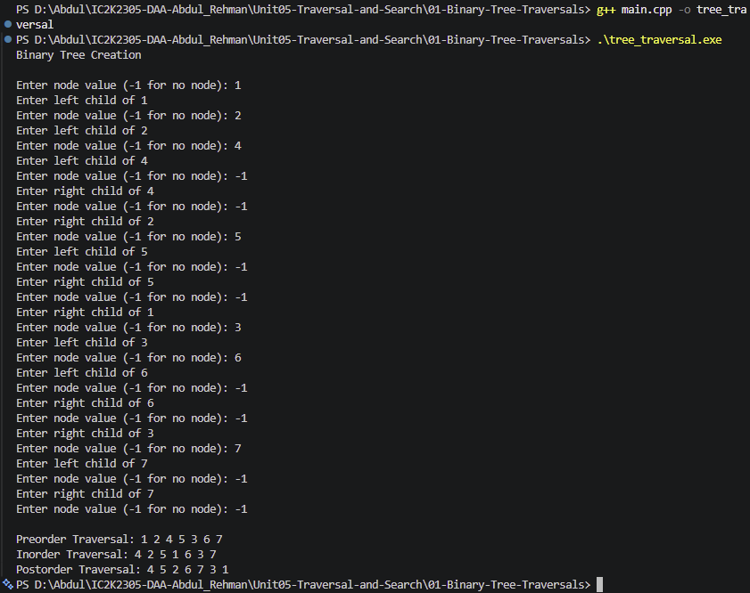

# Experiment 01: Binary Tree Traversals

## Aim

To create a binary tree and perform Preorder, Inorder, and Postorder traversals using recursion in C++.

## Problem Statement

Create a binary tree using dynamically allocated nodes and display its elements using three standard traversal techniques.

## Algorithm / Approach

A binary tree is created recursively. Each node contains data and pointers to its left and right children.

The user enters -1 to indicate that a child node does not exist.

Three recursive traversal methods are implemented:

1. Preorder: Root, Left, Right.
2. Inorder: Left, Root, Right.
3. Postorder: Left, Right, Root.

## Pseudocode

### Tree Creation

1. Read the node value.
2. If the value is -1, return NULL.
3. Create a new node.
4. Recursively create the left child.
5. Recursively create the right child.
6. Return the created node.

### Preorder Traversal

1. If the node is NULL, return.
2. Display the node value.
3. Traverse the left subtree.
4. Traverse the right subtree.

### Inorder Traversal

1. If the node is NULL, return.
2. Traverse the left subtree.
3. Display the node value.
4. Traverse the right subtree.

### Postorder Traversal

1. If the node is NULL, return.
2. Traverse the left subtree.
3. Traverse the right subtree.
4. Display the node value.

## Sample Input

1
2
4
-1
-1
5
-1
-1
3
6
-1
-1
7
-1
-1

## Sample Output

Preorder Traversal: 1 2 4 5 3 6 7

Inorder Traversal: 4 2 5 1 6 3 7

Postorder Traversal: 4 5 2 6 7 3 1

## Time and Space Complexity

**Time Complexity:** O(n) for each traversal.

Every node is visited exactly once.

**Space Complexity:** O(h) auxiliary recursion stack space, where h is the height of the tree. In the worst case, it can be O(n).

The dynamically allocated tree itself requires O(n) space.

## Screenshots

## Learning Outcomes

- Understood the structure of a binary tree.
- Learned how to create tree nodes dynamically.
- Implemented recursive tree creation.
- Learned Preorder, Inorder, and Postorder traversals.
- Understood recursion in tree-based data structures.
- Analyzed traversal time and space complexity.
