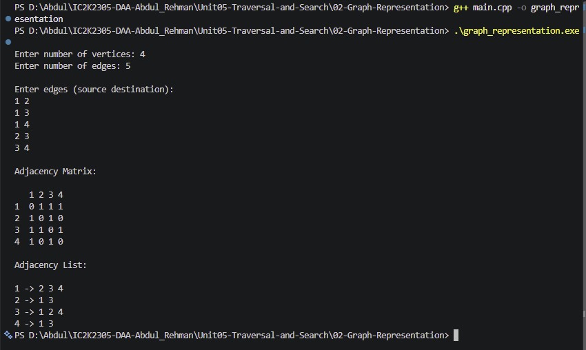

# Experiment 02: Graph Representation

## Aim

To implement graph representation in C++ using Adjacency Matrix and Adjacency List.

## Problem Statement

Given an undirected, unweighted graph, represent it using an adjacency matrix and an adjacency list.

## Algorithm / Approach

The graph is represented using two methods:

### 1. Adjacency Matrix

- Create a two-dimensional matrix of size V × V.
- Initialize all elements to zero.
- For every edge (u, v), set matrix[u][v] = 1 and matrix[v][u] = 1.
- Display the matrix.

### 2. Adjacency List

- Create a list for every vertex.
- For every edge (u, v), add v to the neighbour list of u.
- Add u to the neighbour list of v.
- Display the adjacency list.

## Pseudocode

1. Read the number of vertices and edges.
2. Initialize an adjacency matrix with zeros.
3. Initialize an empty adjacency list for every vertex.
4. Read each edge (u, v).
5. Update the adjacency matrix at positions (u, v) and (v, u).
6. Add v to the adjacency list of u.
7. Add u to the adjacency list of v.
8. Display the adjacency matrix.
9. Display the adjacency list.
10. Stop.

## Sample Input

4
5

1 2
1 3
1 4
2 3
3 4

## Sample Output

Adjacency Matrix:

0 1 1 1
1 0 1 0
1 1 0 1
1 0 1 0

Adjacency List:

1 -> 2 3 4
2 -> 1 3
3 -> 1 2 4
4 -> 1 3

## Time and Space Complexity

### Adjacency Matrix

- Space Complexity: O(V²)
- Edge insertion: O(1)
- Edge existence check: O(1)

### Adjacency List

- Space Complexity: O(V + E)
- Edge insertion: O(1) amortized
- Edge existence check: O(degree(V))

Here:

- V = Number of vertices
- E = Number of edges

## Screenshots

## Learning Outcomes

- Understood the basic structure of graphs.
- Learned the difference between directed and undirected graphs.
- Implemented adjacency matrix representation.
- Implemented adjacency list representation.
- Compared memory requirements and operations of both representations.
