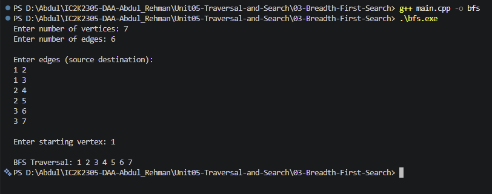

# Experiment 03: Breadth-First Search (BFS)

## Aim

To implement Breadth-First Search (BFS) in C++ to traverse an undirected graph starting from a selected source vertex.

## Problem Statement

Given an undirected graph and a starting vertex, traverse all vertices reachable from the starting vertex using Breadth-First Search.

## Algorithm / Approach

Breadth-First Search is a graph traversal algorithm that explores vertices level by level.

It uses a queue data structure that follows the FIFO (First In, First Out) principle.

The graph is represented using an adjacency list.

### Algorithm

1. Read the number of vertices and edges.
2. Create an adjacency list.
3. Read all edges and update the adjacency list.
4. Read the starting vertex.
5. Create a visited array and initialize all vertices as unvisited.
6. Mark the starting vertex as visited.
7. Insert the starting vertex into the queue.
8. While the queue is not empty:
   - Remove the front vertex.
   - Display the vertex.
   - Visit all its unvisited neighbours.
   - Mark each newly discovered neighbour as visited.
   - Insert each newly discovered neighbour into the queue.
9. Stop when the queue becomes empty.

## Pseudocode

BFS(start):

1. Create an empty queue.
2. Mark start as visited.
3. Insert start into the queue.
4. While the queue is not empty:
   a. Remove the front vertex u.
   b. Display u.
   c. For every neighbour v of u:
   - If v is not visited:
     - Mark v as visited.
     - Insert v into the queue.
5. Stop.

## Sample Input

7
6

1 2
1 3
2 4
2 5
3 6
3 7

Starting vertex: 1

## Sample Output

BFS Traversal: 1 2 3 4 5 6 7

## Time and Space Complexity

**Time Complexity:** O(V + E)

Every vertex is visited at most once, and every edge is examined a constant number of times.

**Auxiliary Space Complexity:** O(V)

The visited array and queue require O(V) space.

The adjacency list itself requires O(V + E) space.

Here:

- V = Number of vertices
- E = Number of edges

## Screenshots

## Learning Outcomes

- Understood Breadth-First Search.
- Learned how to traverse a graph level by level.
- Understood the FIFO principle of queues.
- Implemented BFS using an adjacency list.
- Learned the importance of a visited array.
- Analyzed the time and space complexity of BFS.
