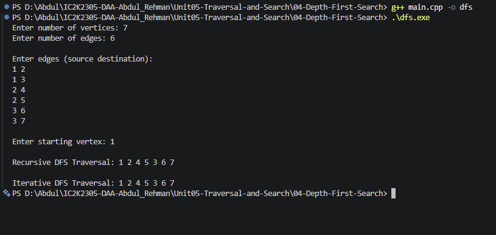

# Experiment 04: Depth-First Search (DFS)

## Aim

To implement Depth-First Search (DFS) in C++ using both recursive and iterative approaches to traverse an undirected graph.

## Problem Statement

Given an undirected graph and a starting vertex, traverse all vertices reachable from the starting vertex using Depth-First Search.

Implement DFS using:

1. Recursion.
2. An explicit stack.

## Algorithm / Approach

Depth-First Search explores a graph by following one path as deeply as possible before backtracking.

The graph is represented using an adjacency list.

### Recursive DFS

1. Start from the selected vertex.
2. Mark the vertex as visited.
3. Display the vertex.
4. Visit each unvisited neighbour recursively.
5. Return when no unvisited neighbour remains.

### Iterative DFS

1. Create an empty stack.
2. Push the starting vertex.
3. While the stack is not empty:
   - Remove the top vertex.
   - If it is already visited, skip it.
   - Otherwise, mark it as visited and display it.
   - Push its unvisited neighbours in reverse adjacency-list order.
4. Stop when the stack becomes empty.

## Pseudocode

### Recursive DFS

DFS(u):

1. Mark u as visited.
2. Display u.
3. For every neighbour v of u:
   - If v is not visited:
     - DFS(v).
4. Return.

### Iterative DFS

1. Create an empty stack.
2. Push the starting vertex.
3. While the stack is not empty:
   a. Pop the top vertex u.
   b. If u is already visited, continue.
   c. Mark u as visited.
   d. Display u.
   e. Push its unvisited neighbours in reverse order.
4. Stop.

## Sample Input

7
6

1 2
1 3
2 4
2 5
3 6
3 7

Starting vertex: 1

## Sample Output

Recursive DFS Traversal: 1 2 4 5 3 6 7

Iterative DFS Traversal: 1 2 4 5 3 6 7

## Time and Space Complexity

**Time Complexity:** O(V + E)

Every vertex is visited at most once, and every edge is examined a constant number of times.

**Recursive DFS auxiliary space:** O(V) for the visited array and recursion stack.

**Iterative DFS auxiliary space:** O(V + E) in the worst case for this implementation, including the visited array and explicit stack. The stack can temporarily contain duplicate entries.

The adjacency list itself requires O(V + E) space.

Here:

- V = Number of vertices
- E = Number of edges

## Screenshots

## Learning Outcomes

- Understood Depth-First Search.
- Learned graph traversal using recursion.
- Learned how to implement DFS using a stack.
- Understood backtracking.
- Compared recursive and iterative DFS.
- Analyzed the time and space complexity of DFS.
