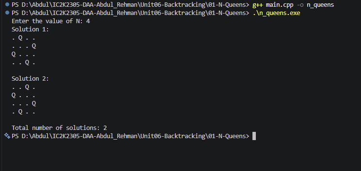

# Experiment 01: N-Queens Problem

## Aim

To solve the N-Queens problem using the Backtracking technique in C++.

## Problem Statement

Place N queens on an N × N chessboard such that no two queens attack each other.

No two queens should share the same row, column, or diagonal.

## Algorithm / Approach

The N-Queens problem is solved using Backtracking.

The program places one queen in each row and checks whether the selected position is safe.

If a safe position is found, the algorithm places the queen and moves to the next row.

If no safe position is available, it backtracks by removing the previously placed queen and trying another position.

The program counts all valid solutions and displays at most the first 20.

## Pseudocode

1. Read the value of N.
2. Create an array to store queen positions.
3. Start placing queens from the first row.
4. For every column in the current row:
   - Check whether the position is safe.
   - If safe, place the queen.
   - Recursively solve the next row.
   - Remove the queen after returning.
5. If all N queens are placed, record a valid solution.
6. Display the total number of solutions.
7. Stop.

## Sample Input

4

## Sample Output

Solution 1:

. Q . .
. . . Q
Q . . .
. . Q .

Solution 2:

. . Q .
Q . . .
. . . Q
. Q . .

Total number of solutions: 2

## Time and Space Complexity

**Time Complexity:** O(N × N!)

The algorithm explores possible queen placements using Backtracking. Each safety check can take O(N) time, and the number of candidate arrangements is bounded by factorial growth.

**Auxiliary Space Complexity:** O(N)

The board array and recursive call stack require O(N) space.

Here, N represents the number of queens and the dimensions of the chessboard.

## Screenshots

## Learning Outcomes

- Understood the N-Queens problem.
- Learned the Backtracking technique.
- Implemented recursive solution generation.
- Understood row, column, and diagonal constraints.
- Learned how invalid choices are removed through backtracking.
- Analyzed the time and space complexity of the algorithm.
