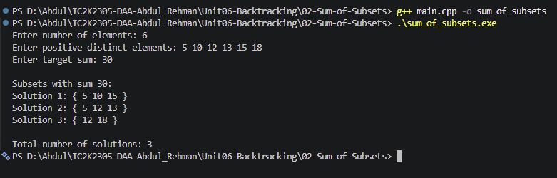

# Experiment 02: Sum of Subsets using Backtracking

## Aim

To implement the Sum of Subsets problem using the Backtracking technique in C++ and find all subsets whose sum equals a given target value.

## Problem Statement

Given a set of positive distinct integers and a target sum, find all possible subsets whose elements add up to the target value.

## Algorithm / Approach

1. Read the elements and target sum.
2. Sort the elements.
3. Start with an empty subset and current sum 0.
4. For each element, explore two choices:
   - Include the current element.
   - Exclude the current element.
5. If the current sum equals the target, display the subset.
6. Stop exploring a branch if:
   - The current sum exceeds the target.
   - All elements are considered.
   - The remaining elements cannot reach the target.
7. Continue until all valid subsets are found.

## Pseudocode

```text
SUM_OF_SUBSETS(index, currentSum):

    IF currentSum = target:
        DISPLAY current subset
        RETURN

    IF index = n:
        RETURN

    IF currentSum > target:
        RETURN

    IF currentSum + remainingSum < target:
        RETURN

    INCLUDE current element
    SUM_OF_SUBSETS(index + 1, newSum)

    REMOVE current element

    EXCLUDE current element
    SUM_OF_SUBSETS(index + 1, currentSum)
```

## Sample Input

```text
Number of elements: 6
Elements: 5 10 12 13 15 18
Target sum: 30
```

## Sample Output

```text
Subsets with sum 30:

Solution 1: { 5 10 15 }
Solution 2: { 5 12 13 }
Solution 3: { 12 18 }

Total number of solutions: 3
```

## Complexity Analysis

- Time Complexity: O(2^n) in the worst case.
- Auxiliary Space Complexity: O(n).
- Sorting Complexity: O(n log n).

## Screenshots



## Learning Outcomes

- Understood the concept of Backtracking.
- Learned how to generate subsets recursively.
- Understood include and exclude decisions.
- Learned how pruning reduces unnecessary exploration.
- Analyzed the time and space complexity of a backtracking algorithm.
