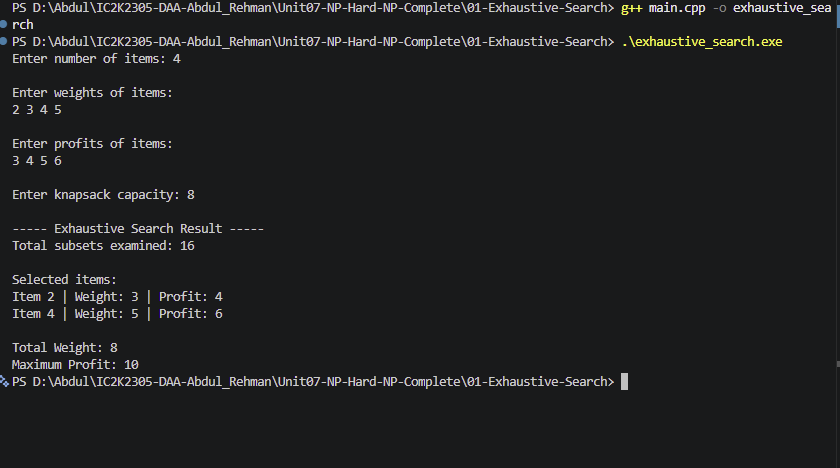

# Experiment 01: Exhaustive Search using 0/1 Knapsack

## Aim

To implement the Exhaustive Search technique in C++ to solve the 0/1 Knapsack problem by examining all possible subsets and finding the maximum profit within the given capacity.

## Problem Statement

Given a set of items, where each item has a weight and profit, select items to maximize the total profit without exceeding the knapsack capacity.

Each item can either be selected completely or rejected.

## Algorithm / Approach

1. Read the number of items, their weights, profits, and knapsack capacity.
2. Generate all possible subsets using recursion.
3. For every item, explore two choices:
   - Include the item.
   - Exclude the item.
4. Calculate the total weight and profit for each subset.
5. Check whether the total weight is within the knapsack capacity.
6. Update the maximum profit whenever a better valid solution is found.
7. Display the selected items and maximum profit.

## Pseudocode

```text
EXHAUSTIVE_SEARCH(index, currentWeight, currentProfit):

    IF index = number of items:

        INCREMENT total subsets examined

        IF currentWeight <= capacity
           AND currentProfit > maxProfit:

            maxProfit = currentProfit
            SAVE current selection

        RETURN

    EXCLUDE current item
    EXHAUSTIVE_SEARCH(next item)

    INCLUDE current item
    EXHAUSTIVE_SEARCH(next item)
```

## Sample Input

```text
Number of items: 4
Weights: 2 3 4 5
Profits: 3 4 5 6
Capacity: 8
```

## Sample Output

```text
Total subsets examined: 16

Selected items:
Item 2 | Weight: 3 | Profit: 4
Item 4 | Weight: 5 | Profit: 6

Total Weight: 8
Maximum Profit: 10
```

## Complexity Analysis

- Subset enumeration: O(2^n)
- Overall worst-case time: O(n \* 2^n)
- Auxiliary space: O(n)

## Screenshots



## Learning Outcomes

- Understood the Exhaustive Search technique.
- Learned how to generate all possible subsets using recursion.
- Understood the Include and Exclude decisions.
- Applied Exhaustive Search to the 0/1 Knapsack problem.
- Analyzed the time and space complexity of an exponential-time algorithm.
