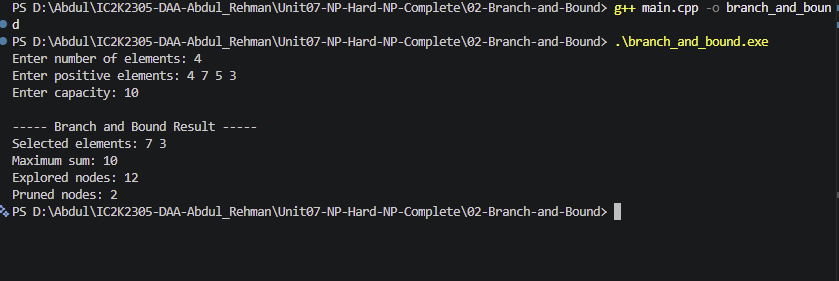

# Experiment 02: Branch and Bound Technique

## Aim

To implement the Branch and Bound technique in C++ to solve an optimization problem by exploring possible solutions and pruning branches that cannot improve the current best solution.

## Problem Statement

Given a set of positive integers and a capacity, find the maximum possible sum of selected elements without exceeding the given capacity.

## Algorithm / Approach

1. Read the elements and capacity.
2. Sort the elements in descending order.
3. Start with an empty selection and current sum 0.
4. For each element, explore two choices:
   - Include the element if capacity permits.
   - Exclude the element.
5. Calculate an upper bound using the current sum and remaining elements.
6. If the upper bound cannot improve the best solution, prune the branch.
7. Update the best solution whenever a better valid sum is found.
8. Display the best selection, maximum sum, explored nodes, and pruned nodes.

## Pseudocode

```text
BRANCH_AND_BOUND(index, currentSum, remainingSum):

    INCREMENT exploredNodes

    IF currentSum > bestSum:
        bestSum = currentSum
        SAVE current selection

    IF index = n:
        RETURN

    upperBound = currentSum + remainingSum

    IF upperBound <= bestSum:
        INCREMENT prunedNodes
        RETURN

    IF currentSum + current element <= capacity:
        INCLUDE current element
        BRANCH_AND_BOUND(next index)

    EXCLUDE current element
    BRANCH_AND_BOUND(next index)
```

## Sample Input

```text
Number of elements: 4
Elements: 4 7 5 3
Capacity: 10
```

## Sample Output

```text
Selected elements: 7 3
Maximum sum: 10
```

## Complexity Analysis

- Worst-case Time Complexity: O(2^n)
- Auxiliary Space Complexity: O(n)
- Actual explored nodes depend on pruning.

## Screenshots



## Learning Outcomes

- Understood the Branch and Bound technique.
- Learned the concepts of branching and bounding.
- Understood how pruning reduces the search space.
- Implemented an optimization problem using Branch and Bound.
- Analyzed explored nodes and pruned nodes.
