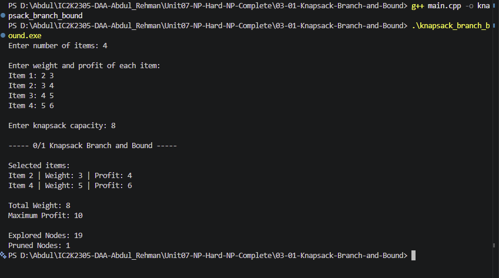

# Experiment 03: 0/1 Knapsack using Branch and Bound

## Aim

To implement the 0/1 Knapsack problem using the Branch and Bound technique in C++ and find the maximum profit without exceeding the given capacity.

## Problem Statement

Given a set of items with their weights and profits, select items to maximize the total profit without exceeding the knapsack capacity.

Each item can either be selected completely or rejected.

## Algorithm / Approach

1. Read the number of items, weights, profits, and capacity.
2. Calculate the profit-to-weight ratio for each item.
3. Sort the items in descending order of their ratios.
4. Start the Branch and Bound search.
5. Generate two branches for every item:
   - Include the item.
   - Exclude the item.
6. Calculate an optimistic upper bound using the Fractional Knapsack approach.
7. Prune a branch if its upper bound cannot improve the current maximum profit.
8. Display the selected items, total weight, maximum profit, explored nodes, and pruned nodes.

## Pseudocode

```text
BRANCH_AND_BOUND(index, currentWeight, currentProfit):

    UPDATE best solution if currentProfit is better

    IF all items are considered:
        RETURN

    upperBound = CALCULATE_BOUND()

    IF upperBound <= maxProfit:
        PRUNE current branch
        RETURN

    IF current item fits:

        INCLUDE current item

        BRANCH_AND_BOUND(next item)

        BACKTRACK

    EXCLUDE current item

    BRANCH_AND_BOUND(next item)
```

## Sample Input

```text
Number of items: 4

Item 1: 2 3
Item 2: 3 4
Item 3: 4 5
Item 4: 5 6

Capacity: 8
```

## Sample Output

```text
Selected items:

Item 2 | Weight: 3 | Profit: 4
Item 4 | Weight: 5 | Profit: 6

Total Weight: 8
Maximum Profit: 10
```

## Complexity Analysis

- Sorting Complexity: O(n log n)
- Worst-case Time Complexity: O(n \* 2^n)
- Auxiliary Space Complexity: O(n)
- Practical performance depends on the number of branches pruned.

## Screenshots



## Learning Outcomes

- Understood the 0/1 Knapsack optimization problem.
- Implemented Branch and Bound in C++.
- Learned to calculate upper bounds using Fractional Knapsack.
- Understood how pruning reduces unnecessary exploration.
- Compared Branch and Bound with Exhaustive Search.
- Analyzed explored nodes and pruned nodes.
