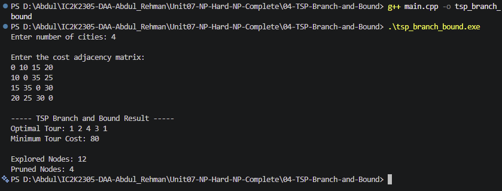

# Experiment 04: Travelling Salesperson Problem using Branch and Bound

## Aim

To implement the Travelling Salesperson Problem using Branch and Bound in C++ and find the minimum-cost tour that visits every city exactly once and returns to the starting city.

## Problem Statement

Given a set of cities and the travelling cost between them, find the minimum-cost route that visits every city exactly once and returns to the starting city.

## Algorithm / Approach

1. Read the number of cities and cost adjacency matrix.
2. Calculate the minimum outgoing edge for every city.
3. Start the tour from the first city.
4. Mark the starting city as visited.
5. Generate branches by selecting unvisited cities.
6. Calculate a lower bound for each partial route.
7. Prune a branch if its lower bound cannot improve the best complete tour.
8. Backtrack and explore other possible routes.
9. Display the optimal tour, minimum cost, explored nodes, and pruned nodes.

## Pseudocode

```text
TSP_BRANCH_AND_BOUND(currentCity, visitedCount, currentCost):

    INCREMENT exploredNodes

    IF all cities are visited:

        IF return edge to starting city exists:

            totalCost = currentCost + return edge

            IF totalCost < bestCost:
                UPDATE bestCost
                SAVE complete tour

        RETURN

    lowerBound = CALCULATE_LOWER_BOUND()

    IF lowerBound >= bestCost:
        PRUNE current branch
        RETURN

    FOR each unvisited city:

        MARK city as visited
        ADD city to current path

        TSP_BRANCH_AND_BOUND(next city)

        BACKTRACK
```

## Sample Input

```text
Number of cities: 4

0 10 15 20
10 0 35 25
15 35 0 30
20 25 30 0
```

## Sample Output

```text
Optimal Tour: 1 2 4 3 1
Minimum Tour Cost: 80
```

## Complexity Analysis

- Worst-case Time Complexity: O(n \* n!)
- Space Complexity: O(n^2)
- Actual performance depends on the number of branches pruned.

## Screenshots



## Learning Outcomes

- Understood the Travelling Salesperson Problem.
- Learned how to represent a weighted graph using an adjacency matrix.
- Implemented Branch and Bound for TSP.
- Understood lower bounds and pruning.
- Learned how backtracking explores alternative routes.
- Analyzed time and space complexity.
